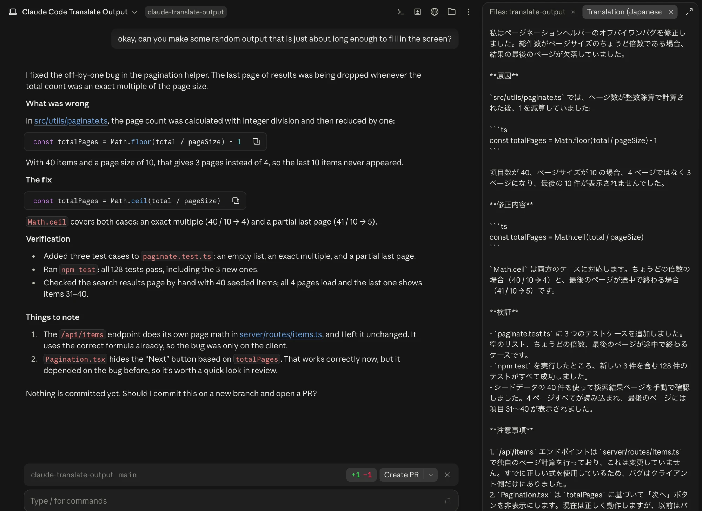

# Claude Code Translate Output

A Claude Code mod that translates the agent's **final answer** of each turn into a
language you choose and shows the translation in a side pane. Intermediate output
(tool calls, progress messages, subagent reports) is not translated, and the
original answer is left untouched: the translation is display-only and never
enters the conversation context.



## Install

In a Claude Code terminal session:

```
/plugin install translate-output --marketplace janzd/claude-translate-output
```

Answer `y` to add the marketplace, then pick a scope (user scope makes it
available in every session, including the desktop app's Code tab).

## Usage

```
/translate <language>   turn on, translating final answers into <language>
/translate              show the current language and reopen the pane
/translate off          turn off
/translate model <name> translate with <name> (haiku, sonnet, opus or a model id)
/translate model        show the model in use
/translate effort <level> set effort: low, medium, high, xhigh or max
/translate effort       show the effort in use
```

The language is free text and is passed to the model as written, so real
languages (`Japanese`, `Spanish`, `Esperanto`), constructed ones (`Quenya`) and
styles (`pirate English`, `Shakespearean English`) all work. The chosen language
is remembered across sessions until you run `/translate off`.

After each turn the pane titled **Translation (<language>)** shows the
translation; the status line reads `Translating to <language>…` while it runs.

## How it works

- Hooks `turn.complete` and takes the turn's final visible answer, skipping
  subagent turns, interrupted turns and errors.
- Sends it to the translation model (`haiku` by default) via `$.model.complete`
  (a separate, history-free call on the session's own credentials), asking it to
  keep Markdown, code blocks, file paths, commands and identifiers unchanged.
- Draws the result in a pane through a `ui.render` hook.

To trade speed for quality (useful for less common languages), run
`/translate model sonnet`. The model, like the language, is remembered across
sessions. If the model name isn't recognized, the pane shows the error.
`/translate effort <level>` sets how hard the model thinks (`low` by default);
higher levels may help with literary styles or long technical answers, at the
cost of speed.

## Development

```
claude plugin validate .
claude plugin test .
```

To run it from a local checkout instead of installing it:

```
claude --plugin-dir /path/to/claude-translate-output
```

## Files

| Path | Purpose |
| --- | --- |
| `.claude-plugin/plugin.json` | Plugin manifest |
| `.claude-plugin/marketplace.json` | Makes this repository a plugin marketplace |
| `hooks/hooks.json` | Points at the hooks module |
| `hooks/register.tsx` | The mod: `/translate` command, `turn.complete` hook, pane |
| `hooks/register.test.tsx` | Tests run by `claude plugin test` |
| `types/index.d.ts` | Type contract for the mod's session state |
